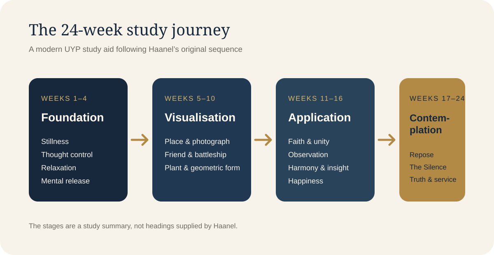
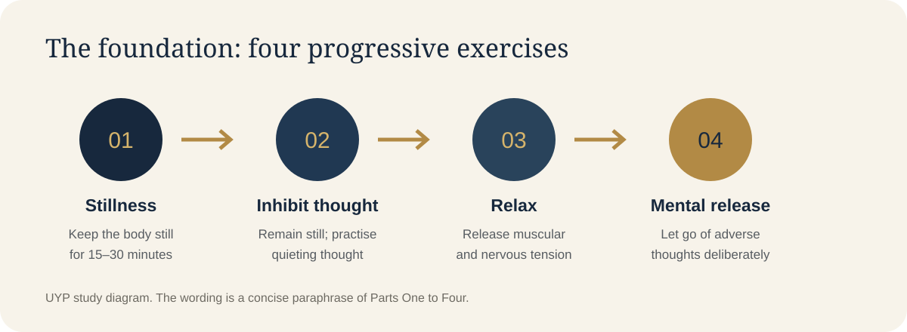
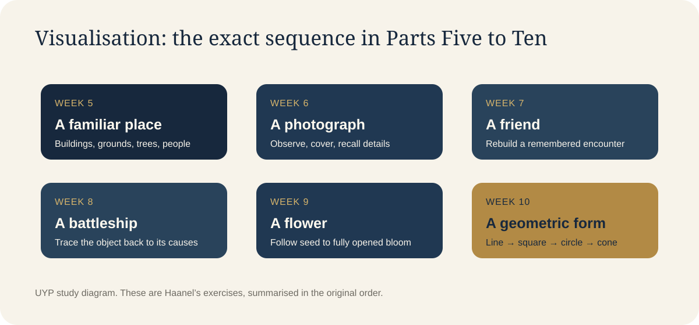
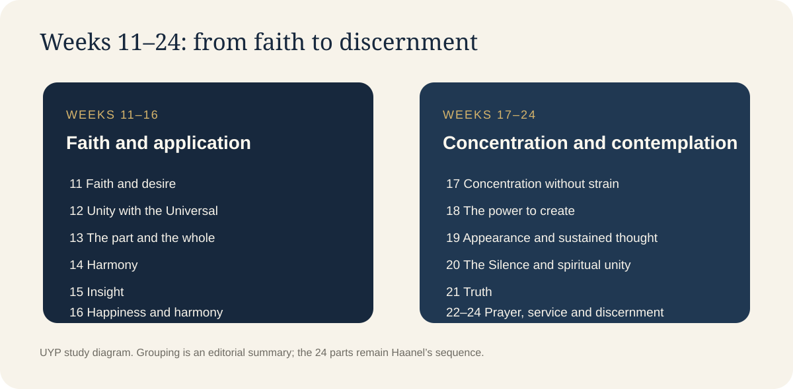

# The Master Key System: A Source-Led 24-Week Study Companion

**A detailed guide to Charles F. Haanel's 24 lessons, their original weekly exercises, the ideas that connect them and what a careful modern reader should—and should not—conclude.**

## How to use this companion

Charles F. Haanel presents *The Master Key System* as a 24-part course, originally studied one part per week. The source edition supplied for this guide advises students not to read the work like a novel: study each part, reread it, reflect on it and practise before moving to the next.

This companion follows that sequence. It is deliberately source-led. Each week separates Haanel's teaching from the exercise he gives and from a short modern reading note. The exercise descriptions are paraphrases of the instructions in the source. No new activity is passed off as Haanel's instruction.

The diagrams in this companion are modern UYP study aids. They are not original Haanel illustrations and do not add new doctrines to the text.

## What the 24 weeks are designed to develop

Across the 24 parts, Haanel moves from physical stillness and mental control to relaxation, imagination, concentration, contemplation and the application of what has been studied. The sequence matters: the early exercises prepare the attention used in the later ones.

## Reading Haanel accurately

Haanel writes from the early twentieth-century New Thought tradition. He uses terms such as **Universal Mind**, **subconscious mind**, **solar plexus**, **vibration**, **Law of Attraction**, **spirit** and **Silence** within his own philosophical and metaphysical framework.

Those terms should not be silently translated into modern neuroscience. For example, Haanel's account of the solar plexus as the centre of subconscious activity is his historical model; it is not the current anatomical understanding of the nervous system. Likewise, his claims that thought directly creates external conditions are philosophical and spiritual claims, not established scientific laws.

A modern reader can study the text respectfully without pretending that every claim has been scientifically demonstrated. The distinction is important throughout this guide.

## The 24 weeks, in the order Haanel gives them

### Week 1 — Part One: Physical stillness

**Haanel's teaching.** The opening part introduces the relationship Haanel sees between the inner world and the outer world, and the importance he places on the individual's predominant mental attitude. He argues that thought and consciousness are central to the way a person experiences life.

**The original exercise.** Choose a room where you can be alone and undisturbed. Sit upright and comfortably, without lounging. Allow your thoughts to roam wherever they will, but keep the body perfectly still for 15 to 30 minutes. Haanel asks the student to continue for several days or a week until physical stillness is under control.

**What to notice.** The first task is physical stillness. Do not replace it with a different meditation technique or demand that the mind become empty; Haanel's first instruction is to remain still while thoughts are allowed to move.

### Week 2 — Part Two: Inhibiting thought

**Haanel's teaching.** Part Two develops the distinction Haanel makes between conscious and subconscious mental activity. He describes the conscious mind as a gatekeeper that can examine what is admitted into the mental world.

**The original exercise.** If possible, return to the same room, chair and position. Remain physically still, but now inhibit thought as far as possible. Haanel acknowledges that this may be possible for only a few moments at first. He wants the student to notice how many thoughts continually seek attention and to persist until greater control is developed.

**What to notice.** The difficulty is part of the demonstration. Observe the movement of thought without turning the exercise into self-criticism.

### Week 3 — Part Three: Physical relaxation

**Haanel's teaching.** Part Three continues the early work on mental and physical control. Haanel describes the nervous system and the solar plexus using the anatomical and metaphysical model common to his period.

**The original exercise.** Continue the previous practice of stillness and inhibiting thought. Now deliberately relax: let the muscles return to their normal condition and release unnecessary tension. Haanel asks the student to determine mentally that every muscle and nerve should relax until a quiet, restful state is reached.

**What to notice.** Relaxation is added to stillness; it does not replace it. Haanel's explanation of the solar plexus is his historical theory, not a modern medical description.

### Week 4 — Part Four: Mental release and the will

**Haanel's teaching.** Part Four turns from physical relaxation to what Haanel calls mental freedom. He discusses the real “I”, the will and the way repeated thought can become easier and more habitual. He introduces the affirmation “I can be what I will to be.”

**The original exercise.** After taking the usual position and relaxing completely, mentally let go of adverse conditions. Haanel names hatred, anger, worry, jealousy, envy, sorrow, trouble and disappointment. He says this is done through voluntary intention and persistence, not by waiting for the feelings to disappear by themselves.

**What to notice.** This is an exercise in deliberately withdrawing attention from destructive thought. It should not be read as a command to deny genuine feelings or avoid seeking help when it is needed.

### Week 5 — Part Five: Visualising a familiar place

**Haanel's teaching.** Part Five discusses the subconscious as a storehouse of impressions and habits, and the importance of directing the mental material that is repeatedly entertained.

**The original exercise.** Go to the usual room and take the same seat and position. Mentally select a place that has pleasant associations. Form a complete mental picture of it: the buildings, grounds, trees, friends, associations and details. Haanel notes that the mind may wander to many unrelated subjects and instructs the student to persist with the chosen picture.

**What to notice.** The task is to construct a coherent, detailed mental image of a real place with which you are familiar. This is not a generic visualisation of a future house or an invented scene.

### Week 6 — Part Six: The photograph

**Haanel's teaching.** Part Six examines attention and concentration. Haanel presents attention as a faculty developed through practice and uses a photograph to make the exercise concrete.

**The original exercise.** Bring a photograph to the same seat, room and position. Examine it closely for at least ten minutes. Notice the expression of the eyes, the features, clothing, hair and every visible detail. Then cover the photograph, close your eyes and try to reconstruct it mentally. If the image is incomplete, repeat the process.

**What to notice.** The exercise moves from careful observation to recall. Accuracy matters more than speed.

### Week 7 — Part Seven: Visualising a friend

**Haanel's teaching.** Part Seven develops idealisation and visualisation. Haanel describes mental imagery as a way of forming a clear idea and explores the relationship he believes exists between image, feeling and action.

**The original exercise.** Visualise a friend exactly as you last saw them. Reconstruct the room, furniture and conversation. See the friend's face distinctly, imagine speaking about a subject of mutual interest and observe their expression changing. Haanel then asks the student to imagine telling an engaging story and to picture the friend's interest and response.

**What to notice.** This is a specific exercise in reconstructing a person and a remembered interaction, not simply imagining success or repeating an affirmation.

### Week 8 — Part Eight: Tracing the battleship to its origins

**Haanel's teaching.** Part Eight asks the student to look beneath appearances and trace visible effects back through the chain of causes that produced them. Haanel connects this kind of observation with imagination, insight, perception and analytical thinking.

**The original exercise.** Take the same position and visualise a battleship. Then trace its origins backwards: the steel plates and foundries, the ore and mines, the engineers and architects, the plans, the decision to build it and the scientific discovery that made it possible for such a vessel to float. Haanel's example moves from the visible ship back through materials, labour, planning, public decisions and underlying knowledge.

**What to notice.** The purpose is not to memorise battleship facts. It is to train the mind to investigate the hidden chain behind a visible result.

### Week 9 — Part Nine: Visualising a plant

**Haanel's teaching.** Part Nine continues the development of concentration through a detailed image. Haanel uses the growth of a plant to illustrate the process by which something develops from an unseen beginning into a visible form. In this part he also gives the affirmation “I am whole, perfect, strong, powerful, loving, harmonious and happy.” He presents it as an expression of spiritual Truth and claims it will bring harmonious conditions; that is Haanel's metaphysical claim, not a scientifically demonstrated effect of repeating the sentence.

**The original exercise.** Choose a flower you admire. Visualise the seed being planted, watered and placed where it receives the morning sun. Follow the roots as they extend, the stem as it rises, the branches and leaves as they form, and the bud as it opens into the flower. Haanel even asks the student to become conscious of the imagined fragrance.

**What to notice.** Build the picture in sequence, with as much clarity and completeness as possible. The exercise develops sustained imagery; it is not a claim that visualising a plant causes a physical plant to grow.

### Week 10 — Part Ten: The geometric drawing

**Haanel's teaching.** Part Ten discusses wealth, power, the application of knowledge and the need to direct thought towards a definite purpose. Its weekly exercise makes concentration precise through a sequence of geometric forms.

**The original exercise.** From your usual position, choose a blank space on the wall or another convenient spot. Mentally draw a black horizontal line about six inches long. Add two vertical lines and a second horizontal line to form a square. Place a circle inside the square, then a point at the centre. Draw the point towards you to form a cone on a square base. Finally, change the image from black to white, red and yellow.

**What to notice.** Follow Haanel's exact sequence: line, square, circle, point, cone and colour changes. The task is to hold and alter a clear mental image deliberately.

### Week 11 — Part Eleven: Desire and faith

**Haanel's teaching.** Part Eleven explores desire, faith and the role of belief in Haanel's account of the creative power of thought. He uses a Biblical passage to focus the lesson.

**The original exercise.** Concentrate on the quotation: “Whatsoever things ye desire, when ye pray, believe that ye receive them and ye shall have them.” Haanel asks the student to consider the certainty implied by the words “whatsoever things” and the meaning he gives to faith.

**What to notice.** Study the relationship Haanel draws between desire, belief and faith. The metaphysical conclusions are his own; the exercise should not be presented as a guarantee that every desired external outcome will occur.

### Week 12 — Part Twelve: Unity with the Universal

**Haanel's teaching.** Part Twelve returns to the Silence and develops Haanel's conception of the relationship between the individual and the Universal Mind. He presents the ability to think as the individual's means of acting upon the Universal.

**The original exercise.** Return to the same room, chair and position. Relax both mentally and physically. Haanel asks the student to realise their unity with Omnipotence and to contemplate the idea that the ability to think is the ability to act upon the Universal Mind. He describes the individual as an expression or part of the whole, differing in degree rather than in kind or quality.

**What to notice.** This is a spiritual and metaphysical contemplation within Haanel's system. It is not a finding established by neuroscience.

### Week 13 — Part Thirteen: The individual as part of the whole

**Haanel's teaching.** Part Thirteen discusses induction, observation and the importance of examining facts before drawing conclusions. Haanel then applies his own metaphysical framework to the relationship between the individual and the whole.

**The original exercise.** Make use of the principle and recognise that you are a part of the whole, and that, in Haanel's view, a part must be the same in kind and quality as the whole, differing only in degree.

**What to notice.** Keep two strands distinct: Haanel's argument for careful observation and induction, and his spiritual claim about the individual and Universal Mind. The first is a method of reasoning; the second is a metaphysical proposition.

### Week 14 — Part Fourteen: Harmony

**Haanel's teaching.** Part Fourteen describes harmony as a condition of constructive thought and considers the relationship between the inner attitude and the conditions experienced in the outer world.

**The original exercise.** Concentrate on Harmony. Haanel explains that concentration means giving the subject such deep and earnest attention that nothing else occupies awareness during the exercise. He emphasises that reading alone is insufficient; the value lies in practical application.

**What to notice.** Use “Harmony” as the single subject of contemplation. Then consider where your thoughts, words and actions are or are not in agreement.

### Week 15 — Part Fifteen: Insight

**Haanel's teaching.** Part Fifteen distinguishes knowing about the creative power of thought from possessing the art of thinking. Haanel argues that knowledge does not apply itself and that action is often governed by custom, precedent and habit.

**The original exercise.** Take your accustomed position and concentrate on Insight. Reflect on the difference between having information and applying it. Continue until you have enough insight to formulate a definite programme for applying the principle to a particular problem of your own.

**What to notice.** The exercise ends with a definite programme, not simply a feeling of inspiration. Identify the personal problem and the application you intend to make.

### Week 16 — Part Sixteen: Happiness and harmony as states of consciousness

**Haanel's teaching.** Part Sixteen discusses wealth, success, use and the creative nature Haanel assigns to thought. Its weekly exercise asks the student to consider happiness and harmony as states of consciousness rather than possessions.

**The original exercise.** Try to realise that harmony and happiness do not depend upon the possession of things. Haanel says the student should seek the mental attitude he believes corresponds with the desired result, and connects that attitude with a realisation of spiritual nature and unity with Universal Mind.

**What to notice.** This is Haanel's philosophical position, not a reason to dismiss material needs or blame people for hardship. A careful modern reading can distinguish inner attitude from the real importance of resources, health, security and external circumstances.

### Week 17 — Part Seventeen: Concentration without strain

**Haanel's teaching.** Part Seventeen explores concentration as becoming identified with the object of thought. Haanel contrasts attention to the underlying reality with the pursuit of outward symbols such as fame, riches or position.

**The original exercise.** Concentrate as nearly as possible according to the method described in the lesson. Relax completely and avoid anxiety about results. Let the thought dwell on the chosen object until you are identified with it and conscious of nothing else. Haanel gives examples: if you wish to eliminate fear, concentrate on courage; if you wish to eliminate lack, concentrate on abundance.

**What to notice.** The instruction is to concentrate on the chosen ideal rather than continually rehearsing the unwanted condition. Haanel's claims about the external effects of this practice remain part of his metaphysical framework.

### Week 18 — Part Eighteen: The power to create

**Haanel's teaching.** Part Eighteen develops attention, interest, knowledge and the relationship between the individual and Universal Intelligence. Haanel presents thought as the connecting link and describes the Law of Love as a principle of growth.

**The original exercise.** Concentrate upon your power to create. Seek insight and perception, and try to find a logical basis for the faith you hold. Haanel asks the student to compare physical life, which depends on air, with spiritual life, which he says depends on a subtler energy. He then asks the student to consider the seed and its fruit as an illustration of causation.

**What to notice.** Follow the analogy as Haanel presents it. Keep his spiritual interpretation separate from the biological facts used in the illustration.

### Week 19 — Part Nineteen: Sustained concentration and appearances

**Haanel's teaching.** Part Nineteen examines polarity, vibration and causation within Haanel's model. It also challenges the assumption that appearances reveal the full nature of things.

**The original exercise.** Become so absorbed in the object of thought that you are conscious of nothing else. Haanel asks for a few minutes of this practice every day. He then asks the student to reflect on how appearances can be deceptive, using historical examples of mistaken assumptions about the Earth, sky, stars and matter.

**What to notice.** The exercise combines sustained attention with intellectual humility: what appears obvious may not be the whole explanation. Haanel's period-specific scientific examples should be read in their historical context.

### Week 20 — Part Twenty: The Silence and spiritual unity

**Haanel's teaching.** Part Twenty develops Haanel's account of cooperation with the Universal rather than attempting to force the Universal through individual will. It presents the Silence as a means of spiritual recognition.

**The original exercise.** Go into the Silence and concentrate on the statement “In him we live and move and have our being.” Haanel asks the student to contemplate that the Universal is omnipresent, that the individual is within it and that a part is the same in kind and quality as the whole.

**What to notice.** This is a direct spiritual contemplation. Preserve Haanel's meaning while recognising that his metaphysical claims are not scientific conclusions.

### Week 21 — Part Twenty-One: Truth

**Haanel's teaching.** Part Twenty-One discusses consciousness of power, the world within and the importance of holding large ideas. Haanel presents the Universal Mind as the source of power and the individual as a channel through which it is expressed.

**The original exercise.** Concentrate on Truth. Haanel asks the student to consider the statement that Truth makes one free, to reflect on the Silence and to contemplate what he describes as the potential power of the world within.

**What to notice.** In Haanel's system, Truth is a spiritual reality. As a practical reader aid, distinguish what you know from what you assume, fear or hope.

### Week 22 — Part Twenty-Two: Spirit meeting spirit

**Haanel's teaching.** Part Twenty-Two explores spiritual presence, prayer, faith and love. It also contains Haanel's views about sickness and mental therapeutics. These are historical spiritual claims and must not be treated as medical advice or evidence that illness is caused by thought.

**The original exercise.** Concentrate on Tennyson's lines: “Speak to Him, thou, for He hears, and spirit with spirit can meet, Closer is He than breathing, and nearer than hands and feet.” Haanel asks the student to contemplate the spiritual meaning he attaches to prayer and contact with Omnipotence.

**What to notice.** Keep the exercise within its spiritual context. It does not replace diagnosis, treatment or support from qualified health professionals.

### Week 23 — Part Twenty-Three: The spiritual “I” and service

**Haanel's teaching.** Part Twenty-Three discusses the individual as a spiritual being with a body, the Universal Mind and the relationship between money, service and exchange. Haanel argues that the value of money is connected with what it enables people to exchange and contribute.

**The original exercise.** Haanel asks the student to contemplate that a person is not merely a body with a spirit, but a spirit with a body. He then develops the relationship between money, service and the creation of harmonious conditions.

**What to notice.** This is a philosophical reflection on identity and exchange. It should not be turned into a promise that spiritual thinking automatically produces wealth.

### Week 24 — Part Twenty-Four: The Truth and continued discernment

**Haanel's teaching.** The final part returns to the Truth about the “I”, the Universal Mind and the distinction between appearance and spiritual reality. Haanel emphasises that another person cannot do the student's thinking or self-culture for them.

**The original exercise.** This week, try to realise what a wonderful world you live in and what a wonderful being you are. Haanel asks the student to reflect on awakening to Truth, the splendours described in his spiritual language and the discrimination between the true and the false.

**What to notice.** The final exercise is a contemplation and review, not a new visualisation task. The course ends by returning responsibility for understanding and self-culture to the student.

## The progression at a glance

| Stage | Weeks | Development in the source |
|---|---:|---|
| Foundation | 1–4 | Physical stillness, inhibiting thought, relaxation and mental release |
| Visualisation | 5–10 | Place, photograph, friend, battleship, plant and geometric form |
| Faith and application | 11–16 | Faith, unity, observation, harmony, insight, happiness and consciousness |
| Concentration and contemplation | 17–24 | Repose, creative thought, sustained concentration, the Silence, Truth, prayer, service and discernment |

## What Haanel means by the mind and the body

Haanel uses the conscious and subconscious mind as explanatory categories. He associates conscious activity with reasoning and will, and subconscious activity with habit, memory and automatic processes. Modern psychology also recognises both deliberate and automatic mental processes, but that does not validate every detail of Haanel's model.

Haanel also gives the solar plexus a central role in subconscious activity and discusses the vagus nerve in his account of the nervous system. Modern anatomy describes the vagus nerve as a major nerve of the autonomic nervous system, connecting the brainstem with organs including the heart, lungs and digestive system. The solar plexus is a network of nerves in the abdomen; it is not recognised as the anatomical seat of the subconscious mind.

There is a real relationship between mental states and bodily processes. But there is no established evidence that affirmations travel through the vagus nerve to the solar plexus and become subconscious commands. The historical theory and modern anatomical account should not be conflated.

## What modern research can responsibly add

Modern research supports a limited set of connections: attention can be practised; repeated behaviour in a stable context can become more automatic; and learning can change the functioning of neural networks, a broad phenomenon often described as neuroplasticity. Some self-affirmation interventions can have modest effects in certain settings. None of this validates Haanel's metaphysical claims.

That evidence does not establish Haanel's metaphysical Law of Attraction, the existence of a Universal Mind, or the claim that thought directly rearranges external events. Nor does it show that affirmations emit special electromagnetic frequencies that attract money, people or circumstances.

A frequently cited habit study by Lally and colleagues (2010) found wide variation in the time taken for everyday behaviours to approach automaticity. Among participants whose data fitted the model, estimates ranged from 18 to 254 days, with a median of about 66 days. This was a study of everyday habits, not a test of Haanel's affirmations or a timetable for personal transformation.

A 2025 meta-analysis of self-affirmation interventions reported small positive effects across several wellbeing measures. The interventions studied were varied and are not equivalent to repeating Haanel's exact affirmations. These findings should not be used to claim that the Master Key System has been scientifically proven.

**The honest conclusion:** modern research can help explain attention, practice, learning and habit. It cannot validate every spiritual claim in Haanel's book. The two perspectives can be discussed side by side, provided they are clearly distinguished.

## A disciplined way to study each part

The following is a modern study structure to help the reader work through Haanel's original weekly sequence. It is a UYP learning aid, not a claim that Haanel prescribed this exact timetable.

1. **Read.** Study the week's part slowly. Note the terms and ideas Haanel repeats.
2. **Reread.** Return to the sections that are difficult or unfamiliar.
3. **Practise.** Complete the weekly exercise as Haanel describes it.
4. **Observe.** Record what happened during the exercise without inventing results.
5. **Apply.** Where the lesson calls for application, identify one real decision or behaviour to which it can be applied.
6. **Review.** At the end of the week, write what you understood, what remains unclear and what you will continue practising.

The sequence is more important than trying to rush through the material. If an exercise is difficult, return to it and practise. Difficulty is not proof of failure.

## The central distinction: thought, belief and action

Haanel makes strong claims about thought as a creative principle. In his framework, thought, feeling, the Universal Mind and the Law of Attraction are connected. A careful modern reading should neither disguise these as proven science nor erase them from the text.

There is also a practical lesson that does not require accepting every metaphysical claim: what a person repeatedly attends to can influence what they notice, how they interpret events and which actions they take. Clear intention can support planning. Concentration can support sustained work. Reflection can expose habits. Consistent action is still necessary, and circumstances beyond an individual's control remain real.

The value of this 24-week study is in reading Haanel carefully, practising the exercises he actually gives, questioning claims honestly and taking responsibility for the actions that follow.

## Source note and copyright

This companion is an original paraphrase and study aid based on the supplied edition of *The Master Key System*. It does not reproduce that edition's study questions, editorial notes or extended passages. The supplied edition distinguishes Haanel's original public-domain work from the particular edited e-book file; this companion does not reproduce the edited edition. Readers should consult a lawful copy of the original work for the complete text.

## Selected research

- Lally, P., van Jaarsveld, C. H. M., Potts, H. W. W., and Wardle, J. (2010). *How are habits formed: Modelling habit formation in the real world.* European Journal of Social Psychology, 40(6), 998–1009. https://doi.org/10.1002/ejsp.674
- Zhang, Y., Chen, B., Hu, X., and Wang, M. (2025). *The impact of self-affirmation interventions on well-being: A meta-analysis.* American Psychologist. https://doi.org/10.1037/amp0001591

## Begin your own seven-day experience

If you would like guided support while studying these principles, begin with **7 Days to Change the Way You Use Your Mind**.

Start at https://unleashyourpowerwithtariq.com/start-free/

*Unleash Your Power — independent study, disciplined practice and conscious application.*

---

**SEO title:** The Master Key System: A Source-Led 24-Week Study Companion | Unleash Your Power

**Meta description:** Explore all 24 parts of Charles F. Haanel's Master Key System, with accurate weekly exercises, illustrated study aids and a clear distinction between Haanel's philosophy and modern evidence.

**Suggested excerpt:** A detailed, source-led guide to Haanel's 24 lessons and the exercises he actually gives—from stillness and visualisation to concentration, the Silence and Truth.
